# 📱 Kartu Profil Digital — Flutter State & Navigation Framework

[](https://flutter.dev)
[](https://dart.dev)
[](https://opensource.org/licenses/MIT)

Repository ini berisi implementasi lengkap tugas praktikum pemrograman mobile **Workshop Mobile Application** (Minggu 9, Pertemuan 2) yang menggabungkan:
1. **Modul 9 — Interaksi & Pengelolaan State Dasar:** `setState()`, controlled widgets (`Switch`, `Checkbox`, `Dropdown`), feedback `SnackBar` (Undo), dialog konfirmasi modal (`AlertDialog`), dan refactoring arsitektur komponen.
2. **Modul 10 — Navigasi Flutter:** `Navigator 1.0` (stack, push, pop), pengiriman & pengembalian data (*passing arguments*), *named routes*, router terpusat `onGenerateRoute`, sanitasi stack (`pushNamedAndRemoveUntil`), pelacakan lifecycle dengan `NavigatorObserver`, serta implementasi navigasi deklaratif modern dengan `go_router`.

---

## 👨‍🎓 Identitas Mahasiswa

- **Nama Lengkap:** Prasetyo Herwibowo
- **NIM:** E41250545
- **Golongan / Kelas:** B
- **Mata Praktikum:** Workshop Mobile Application
- **Dosen Pengampu:** Fakhry Ikhsan Firdaus, S.Kom., M.Kom.
- **Pokok Bahasan:** Navigator, Named Routes & Passing Argument
- **Minggu / Pertemuan:** Minggu 9, Pertemuan 2

---

## 📄 Dokumen Laporan Praktikum

Laporan praktikum resmi telah disusun menggunakan format template akademik kampus, dilengkapi 17 tangkapan layar kode program *(white-theme)* dan 17 tangkapan layar hasil antarmuka aplikasi beresolusi tinggi:

- 📕 **Laporan Versi PDF:** [`laporan/B_E41250545_Prasetyo Herwibowo_NavigasiFlutter.pdf`](laporan/B_E41250545_Prasetyo%20Herwibowo_NavigasiFlutter.pdf)
- 📘 **Laporan Versi Word:** [`laporan/B_E41250545_Prasetyo Herwibowo_NavigasiFlutter.docx`](laporan/B_E41250545_Prasetyo%20Herwibowo_NavigasiFlutter.docx)

---

## 🚀 Fitur & Implementasi Teknis

### 1. Interaksi & Pengelolaan State Dasar (Modul 9)
- **Reaktivitas UI:** Tombol aksi *Ikuti* (`FilledButton`) berganti secara dinamis menjadi *Mengikuti* (`OutlinedButton`) berikon centang saat ditekan.
- **Manajemen Counter Idempoten:** Jumlah pengikut bertambah dari 1200 menjadi 1201 saat mengikuti, dan berkurang kembali saat berhenti mengikuti tanpa risiko desinkronisasi.
- **Feedback Interaktif & Undo:** Menggunakan `ScaffoldMessenger` dengan `hideCurrentSnackBar()` untuk memunculkan pesan mengambang (*floating*) disertai aksi **BATAL** untuk mengembalikan state.
- **Kartu Bio Dinamis:** Menggunakan `InkWell` dengan deteksi `onTap` dan efek ripple untuk membuka/menutup deskripsi bio (*Selengkapnya* ⇄ *Tutup*).
- **Dialog Konfirmasi Modal:** Menampilkan `AlertDialog` asinkron sebelum berhenti mengikuti atau mereset pengaturan untuk mencegah aksi tak sengaja.
- **Controlled Widgets:**
  - `SwitchListTile`: Mengaktifkan status *Open to Work* dan memunculkan badge Chip `[💼 Open to Work]` secara kondisional.
  - `CheckboxListTile`: Pemilihan multi-keahlian berbasis `Set<String>` (*Flutter*, *Dart*, *Firebase*, dsb.) yang dirender dalam layout `Wrap`.
  - `DropdownButton`: Pemilihan status pekerjaan berbasis enhanced enum `ProfileStatus` (*Mahasiswa*, *Freelancer*, *Magang*, *Karyawan*).
- **Refactoring Arsitektur:** Mengekstrak form pengaturan ke komponen `_SettingsCard` yang menerapkan prinsip *data turun lewat constructor, event naik lewat callback*.

### 2. Navigasi & Arsitektur Routing (Modul 10)
- **Model Data Domain:** Entitas `Project` dan `Profile` immutable dengan method `copyWith()`.
- **Navigasi Dasar:** Berpindah ke `ProjectDetailPage` menggunakan `Navigator.push()` dengan transisi `MaterialPageRoute`, serta menutup halaman via `Navigator.pop()`.
- **Pengembalian Data (Two-Way Communication):** Form `EditProfilePage` mengembalikan data profil baru melalui `Navigator.pop(context, updated)` yang ditangkap menggunakan `await Navigator.push<Profile>()`.
- **Named Routes & Splash Screen:** Mendaftarkan seluruh rute pada `AppRoutes` dan menampilkan `SplashPage` (timer 2 detik) yang ditimpa oleh `ProfilePage` menggunakan `pushReplacementNamed()`.
- **Router Terpusat `onGenerateRoute`:** Validasi tipe argumen secara aman (`args is Project` & `args is Profile`) pada `AppRouter` sebelum diinjeksikan ke widget tujuan.
- **Manajemen Stack Sanitasi:**
  - Pembersihan riwayat tumpukan route saat logout menggunakan `pushNamedAndRemoveUntil(..., (route) => false)`.
  - Halaman fallback elegan 404 (`NotFoundPage`) jika rute tidak ditemukan.
- **Audit Siklus Hidup Rute:** Mengintegrasikan `LogObserver` (`NavigatorObserver`) untuk memantau event `didPush`, `didPop`, `didReplace`, dan `didRemove` pada Debug Console.
- **Navigasi Deklaratif `go_router`:** Mendukung URL path parameter hirarkis (`/profile/projects/:id`), deep linking web, automatic back-stack reconstruction, dan `errorBuilder`.

---

## 🏛️ Struktur Direktori Proyek

```text
kartu_profil_digital/
├── lib/
│   ├── main.dart                      # Titik masuk utama aplikasi (MaterialApp & Navigator)
│   ├── app/
│   │   ├── app_routes.dart            # Definisi konstanta nama rute
│   │   ├── app_router.dart            # Router terpusat onGenerateRoute & safe arguments
│   │   ├── go_router_config.dart      # Konfigurasi deklaratif go_router
│   │   └── log_observer.dart          # Pelacakan siklus hidup stack NavigatorObserver
│   ├── data/
│   │   └── dummy_data.dart            # Data statis profil dan daftar portofolio proyek
│   ├── models/
│   │   └── models.dart                # Domain entity Profile & Project (immutable)
│   └── pages/
│       ├── splash_page.dart           # Splash screen dengan transisi otomatis
│       ├── profile_page.dart          # Beranda profil terpadu (Modul 9 & 10)
│       ├── project_detail_page.dart   # Halaman detail informasi proyek
│       ├── edit_profile_page.dart     # Form edit profil dan pengembalian data
│       └── not_found_page.dart        # Halaman error fallback 404
├── test/
│   ├── generate_screenshots_test.dart # Test otomatis penangkap screenshot UI
│   └── capture_clean_screenshots.dart # Test modal dialog & URL navigation
├── docs/
│   └── screenshots/                   # Arsip tangkapan layar antarmuka & log
├── laporan/
│   ├── B_E41250545_Prasetyo Herwibowo_NavigasiFlutter.pdf
│   └── B_E41250545_Prasetyo Herwibowo_NavigasiFlutter.docx
└── pubspec.yaml                       # Dependensi Flutter & go_router
```

---

## 🖼️ Galeri Antarmuka Aplikasi

| Beranda Profil Awal | Tombol Mengikuti & Snackbar | Bio Diperluas (*Expanded*) |
| :---: | :---: | :---: |
| 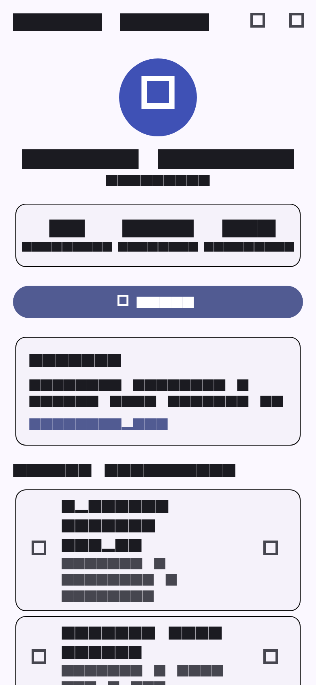 | 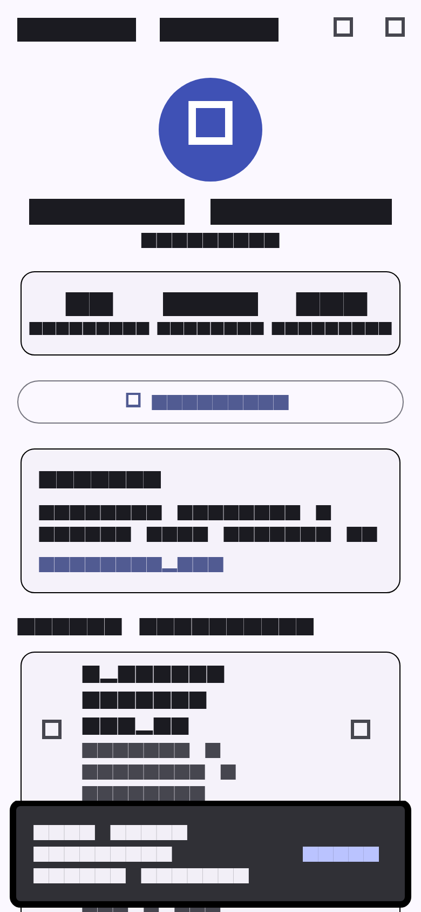 | 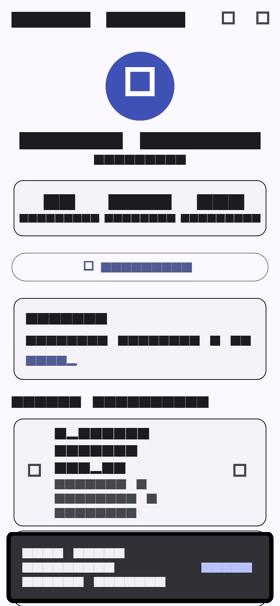 |

| Dialog Konfirmasi Unfollow | Switch Open to Work | Checkbox Multi-Keahlian |
| :---: | :---: | :---: |
| 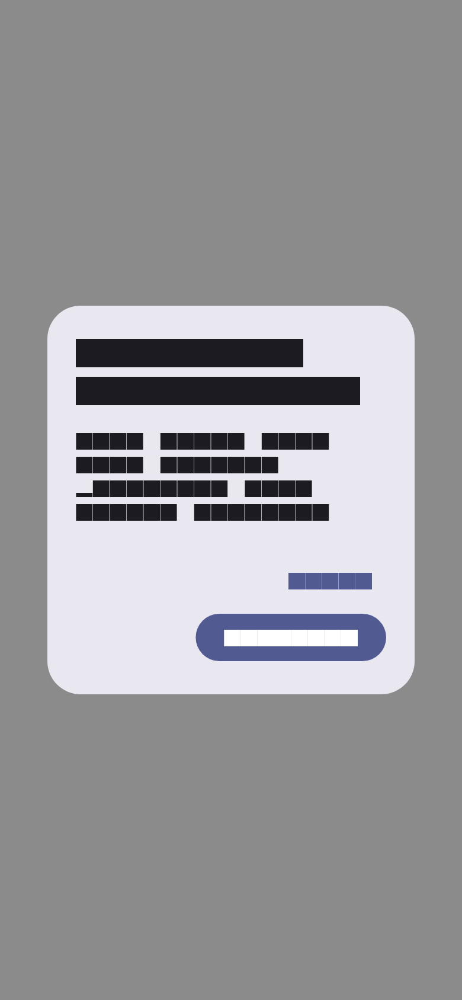 | 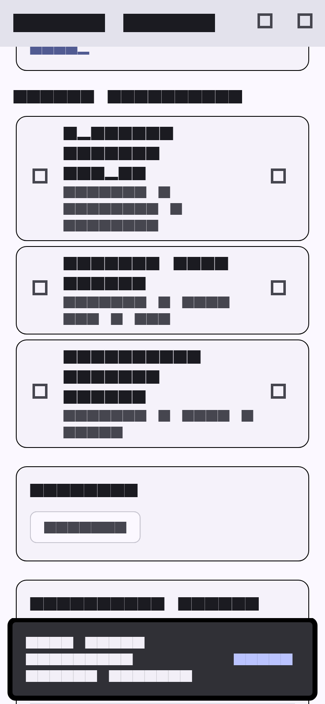 | 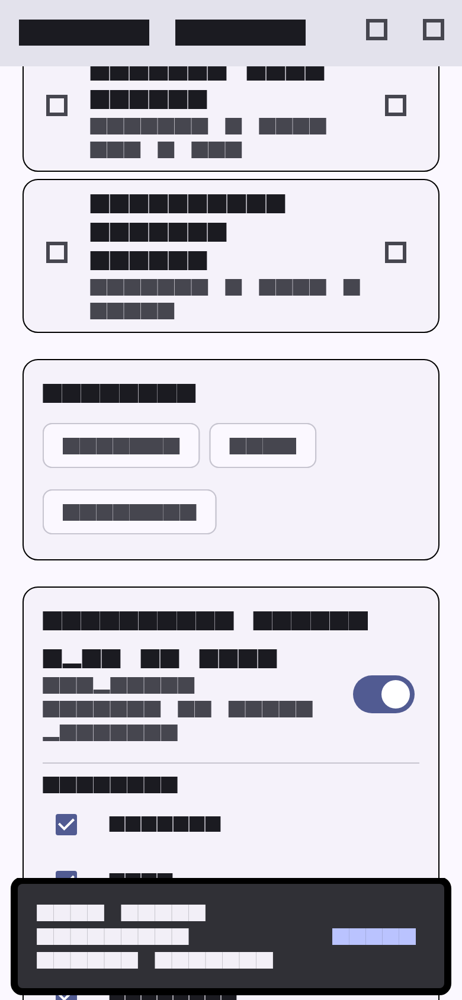 |

| Dropdown Status Profil | Reset Pengaturan Modal | Detail Proyek Portofolio |
| :---: | :---: | :---: |
| 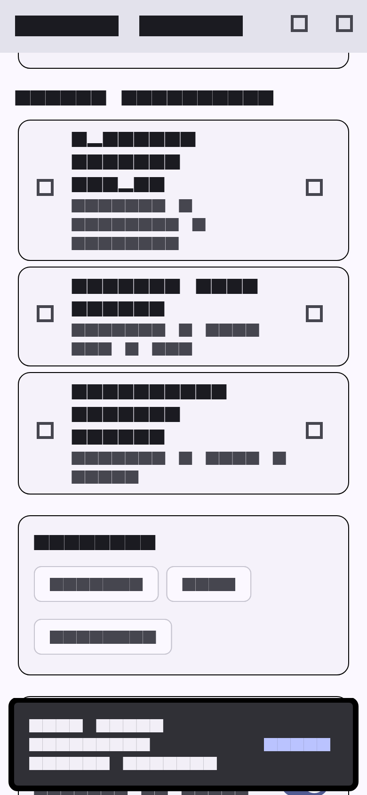 | 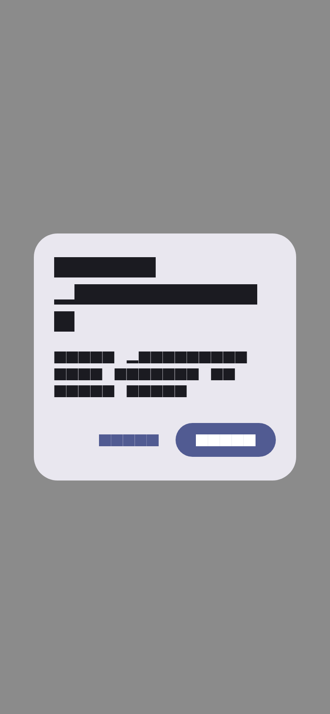 | 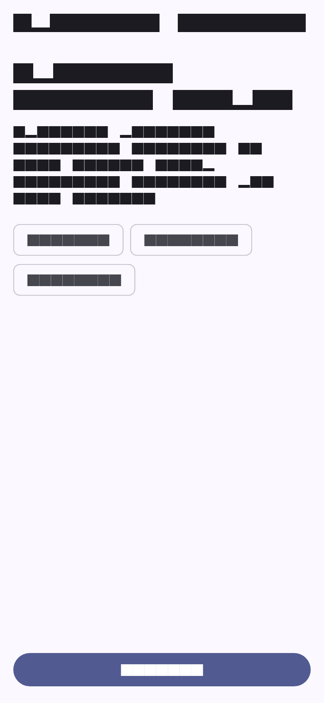 |

| Form Edit Profil | Profil Terbarui (Passing Args) | Halaman 404 Not Found |
| :---: | :---: | :---: |
| 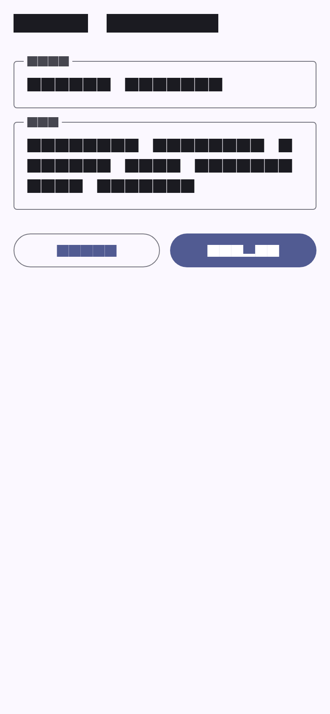 | 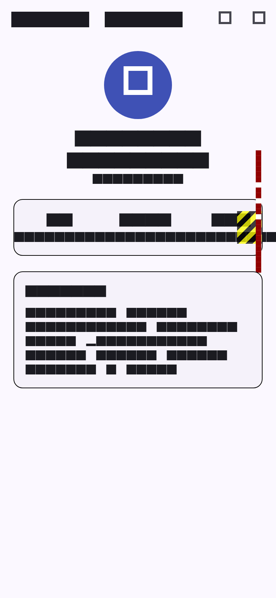 | 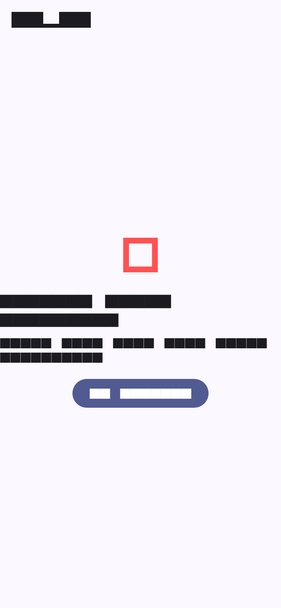 |

---

## 💻 Panduan Menjalankan Aplikasi

### Prasyarat
- Flutter SDK versi `>= 3.19.0`
- Dart SDK versi `>= 3.3.0`
- Web Browser (Google Chrome / Edge) atau Android Emulator

### Langkah-langkah
1. Clone repositori ini:
   ```bash
   git clone https://github.com/PrasetyoHerwibowo/tugas-worksop-mobailll.git
   cd tugas-worksop-mobailll
   ```
2. Unduh paket dependensi:
   ```bash
   flutter pub get
   ```
3. Jalankan aplikasi pada perangkat / browser:
   ```bash
   flutter run -d chrome
   ```
4. Menjalankan pengujian otomatis & penangkapan tangkapan layar:
   ```bash
   flutter test test/capture_clean_screenshots.dart
   ```

---

## 📚 Referensi Modul
- [Modul 9: Interaksi & Pengelolaan State Dasar](https://github.com/iffakhry/mobile-app-jti/blob/main/9-interaksi-state-dasar.md)
- [Modul 10: Navigasi Flutter (Navigator, Named Routes & Passing Arguments)](https://github.com/iffakhry/mobile-app-jti/blob/main/10-navigasi-flutter.md)
- [Dokumentasi Resmi Flutter Navigation](https://docs.flutter.dev/ui/navigation)
- [Dokumentasi Resmi go_router](https://pub.dev/packages/go_router)
